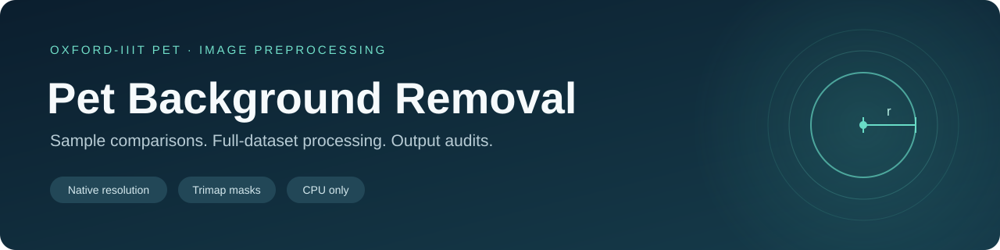

<p align="center">
  
</p>

<p align="center">
  <strong>Inspect the boundary. Choose a radius. Process the dataset. Audit the outputs.</strong>
</p>

<p align="center">
  <a href="#quick-start">Quick start</a> ·
  <a href="#scripts-and-defaults">Scripts</a> ·
  <a href="docs/method.md">Processing method</a> ·
  <a href="docs/reproducibility.md">Reproducibility</a>
</p>

# Pet Background Removal

Prepare black-background pet images from **JPG/JPEG originals and existing PNG
trimap annotations**. This project supports sample comparisons, full-dataset
processing, and a separate filename audit for batch outputs.

- **Original resolution:** no resize, crop, padding, normalization, or EXIF rotation.
- **Controlled erosion:** a circular probe with an adjustable radius in original-image pixels.
- **Animal protection:** label-1 pixels are preserved by default in the current scripts.
- **Traceable outputs:** CSV logs, JSON settings, and unmatched-file reports.
- **CPU processing:** NumPy, Pillow, and SciPy; no GPU, CUDA, model weights, or training.

The output is an **opaque RGB PNG with a black background**, rather than a
transparent cutout. The supplied trimap determines the foreground; the scripts
do not predict a new segmentation mask.

## Quick start

### 1. Install the packages

Use Python **3.10 or later**. Open a terminal in the project folder and run:

```bash
python -m pip install -r requirements.txt
```

<details>
<summary>Optional: create an isolated Python environment</summary>

```bash
python -m venv .venv
```

| Terminal | Activation command |
| --- | --- |
| Windows PowerShell | `.venv\Scripts\Activate.ps1` |
| Windows Command Prompt | `.venv\Scripts\activate.bat` |
| macOS / Linux | `source .venv/bin/activate` |

After activation, run the installation command above. On Windows, `py` can be
used in place of `python` if that is your configured Python launcher.

</details>

### 2. Prepare the two input folders

The repository contains **code and documentation only**. Provide your own images
and trimaps, for example from the
[official Oxford-IIIT Pet dataset](https://www.robots.ox.ac.uk/~vgg/data/pets/).
Use its original label PNGs, not colored mask screenshots.

| Folder relative to the project | What to place inside |
| --- | --- |
| `original/` | Original JPG/JPEG images, for example `Abyssinian_1.jpg`. |
| `masks/` | Matching PNG trimaps, for example `Abyssinian_1.png`. |

Matching uses the **complete filename stem**, ignoring letter case. Only files
directly inside the chosen folders are read; subfolders are not scanned.

### 3. Preview, then process

Start with the sample workflow:

```bash
python remove_pet_background.py
```

Inspect `background_removed/comparisons/` and the full-resolution images in
`background_removed/r_09/`. Choose the radius and protection setting for your
experiment, then run the batch workflow with those same settings:

```bash
python remove_pet_background_BatchProcessing.py
```

Finally, audit the flat batch output folder:

```bash
python audit_pet_outputs_new.py
```

The audit copies originals with no corresponding output PNG into a fresh
`unprocessed_originals/run_.../` folder by default. Add `--no-copy-unprocessed`
if you only want reports.

## Scripts and defaults

The filenames from the supplied package are retained for traceability. Settings
near the beginning of each entry script remain editable; command-line options
override them for one invocation.

| File | Purpose | Defaults / outputs |
| --- | --- | --- |
| [`remove_pet_background.py`](remove_pet_background.py) | Sample originals and compare erosion radii. | Radius **9**, animal protection **on**, up to **35** originals, seed **42**; outputs to `background_removed/`. |
| [`remove_pet_background_BatchProcessing.py`](remove_pet_background_BatchProcessing.py) | Process every matched original at one radius. | Radius **9**, animal protection **on**; outputs to `background_removed_all/`. |
| [`audit_pet_outputs_new.py`](audit_pet_outputs_new.py) | Audit flat batch output filenames, counts, and last-run log membership. | Reports in `image_count_audit/`; copies absent-output originals by default. |
| [`remove_pet_background_old.py`](remove_pet_background_old.py) | Reproduce the earlier unprotected sample workflow. | Radius **3**, animal protection **off**, up to **10** originals, seed **42**; outputs to `background_removed_legacy/`. |
| [`pet_background_utils.py`](pet_background_utils.py) | Shared loading, validation, erosion, output, and sample-processing functions. | Imported by the processing scripts; shared utilities are listed here once. |

Both sample workflows compare `[0, 3, 6, 9, 12]` plus the selected main radius by
default. They sample from the original-image list **before** checking masks.
Selected images with missing masks are logged and are not replaced by other
images. If fewer originals exist than requested, all available originals are
selected in the seeded sample order.

The legacy workflow is optional. It is not an additional step in the main
preview → batch → audit sequence. Its separate output folder prevents it from
overwriting the current protected sample results.

## Command-line examples

Run any entry script with `--help` for its options. Paths containing spaces
should be quoted. The single-line examples work without shell-specific line
continuations.

**Use folders outside the repository:**

```bash
python remove_pet_background_BatchProcessing.py --originals "/path/to/images" --masks "/path/to/trimaps" --output "/path/to/results" --radius 9
```

**Use Windows folders:**

```powershell
python remove_pet_background_BatchProcessing.py --originals "D:\Pets\images" --masks "D:\Pets\annotations\trimaps" --output "D:\Pets\foreground_r9" --radius 9
```

**Compare a smaller sample at chosen radii:**

```bash
python remove_pet_background.py --sample-size 10 --seed 42 --radius 6 --compare-radii 0 3 6 9
```

**Generate only the main radius and omit comparison sheets:**

```bash
python remove_pet_background.py --radius 9 --compare-radii
```

**Run unprotected erosion deliberately:**

```bash
python remove_pet_background_BatchProcessing.py --radius 3 --no-protect-animal-region --output background_removed_unprotected
```

**Audit a custom flat output folder without copying originals:**

```bash
python audit_pet_outputs_new.py --output background_removed_unprotected --no-copy-unprocessed
```

Use a new output folder when changing settings. Existing results with the same
names are overwritten, while other old files remain. Source images and masks
are never moved or deleted. Output folders are validated to avoid overlapping
the input folders.

## How the mask is processed

| Label | Meaning | Processing |
| --- | --- | --- |
| `1` | Animal | Initially retained; restored after erosion when protection is enabled. |
| `2` | Background | Always excluded and filled with black. |
| `3` | Uncertain boundary / edge | Initially retained; may be removed by erosion. |

1. Read the original as RGB and the mask as its stored 8-bit label indices.
2. Verify a 2D mask, matching image dimensions, and labels drawn only from `1/2/3`.
3. Create a binary keep mask from labels `1` and `3`.
4. Apply one binary erosion with a Euclidean disk of radius `r`.
5. If enabled, restore all original label-1 pixels.
6. Copy retained decoded RGB pixels onto a black array and save a PNG.

`r = 0` skips erosion and keeps labels 1 and 3. The image boundary uses
`border_value=1`, so positions outside the photograph do not act as extra
background. A mask can contain a subset of the allowed labels. A palette-mode
PNG is valid when its stored indices contain the correct labels.

See [the processing method](docs/method.md) for the exact operation and its
limitations. The default radius is a configuration value, not a claim that it
is optimal for every image or downstream classifier.

## Output files

| Workflow | File or directory | Contents |
| --- | --- | --- |
| Sample / legacy | `r_00/`, `r_03/`, … | Separate full-resolution PNGs for each requested radius. |
| Sample / legacy | `comparisons/` | Labeled comparison sheets; for visual inspection only. |
| Batch | `<original_stem>.png` | One full-resolution PNG per successful pair, directly in the output folder. |
| Batch | `missing_masks.csv` | Originals skipped because their mask is absent. |
| Batch | `masks_without_originals.csv` | Masks without a matching original. |
| Processing | `processing_log.csv` | Status, dimensions, radii, pixel counts, output names, and errors. |
| Processing | `run_summary.json` | Run settings, counts, and relevant filenames. |
| Audit | `count_summary.json` | Folder counts, unexpected/missing outputs, warnings, and copy information. |
| Audit | `file_audit.csv` | Individual filename/count issues and folder entries. |
| Audit | `unprocessed_originals.csv` | Originals with no corresponding PNG and any copy results. |

The batch audit is for the **flat batch output directory**, not the sample
directory containing radius subfolders. It checks file presence and log
membership; it does not decode output images or certify their pixel values.
A stale PNG can be flagged as unexpected even though it exists. Such a file
also means its original is not classified as absent-output and is not copied.

## Checks and exit codes

Run the included checks without downloading the dataset:

```bash
python -m unittest discover -s tests -v
```

The tests use small synthetic images and trimaps to check the processing
contract and error handling. The GitHub Actions workflow runs the same command
on Python 3.10 and 3.12; this archive does not claim a hosted CI run has occurred.

Local validation passed **19 tests** with Python **3.12.14**, NumPy **2.3.5**,
Pillow **12.3.0**, and SciPy **1.17.0**. Comparisons with the supplied scripts
also produced identical PNG and CSV files for the tested sample, legacy, and
batch fixtures; JSON matched apart from the intentionally different output paths.

| Script | Exit `0` | Exit `1` |
| --- | --- | --- |
| Current / legacy sample | All selected images succeeded. | A selected mask was missing or an image failed. |
| Batch | No matched pair failed; missing masks are recorded as skips. | A matched pair failed. |
| Audit | Reports completed, including when issues were found. | A run error or requested copy failed. |

Invalid settings, missing input folders, or a report-writing error also fail
the invocation. Argument-parsing errors use argparse's exit code `2`.

## Troubleshooting

| Symptom | Check |
| --- | --- |
| No originals found | Point to the folder directly containing JPG/JPEG files. |
| Missing masks | Match the full filename stem, not just the breed name. |
| Duplicate basename | Remove ambiguity such as both `cat_1.jpg` and `cat_1.jpeg`. |
| Invalid mask format | Use the original 2D 8-bit trimap, not a color preview. |
| Size mismatch | Use the mask corresponding to that exact original image; do not resize either input independently. |
| Fur disappears | Some real animal pixels may be labeled 3. Reduce the radius and inspect comparisons. |
| More folder entries than PNG outputs | CSV/JSON files and subfolders count as entries, not processed images. |
| Old images remain | Use a fresh output folder and consult the latest run's logs. |

## Project notes

The workflow is a preprocessing stage for image experiments. It does not
create train/validation/test splits, extract ResNet18 features, or train an SVM.
Use the same input preparation and settings as the experiment you are reporting.

- [Reproducibility and execution guide](docs/reproducibility.md)
- [Revision notes](CHANGELOG.md)
- [Oxford-IIIT Pet dataset, citation, and terms](https://www.robots.ox.ac.uk/~vgg/data/pets/)

Dataset images and annotations remain distributed separately by their creators.
