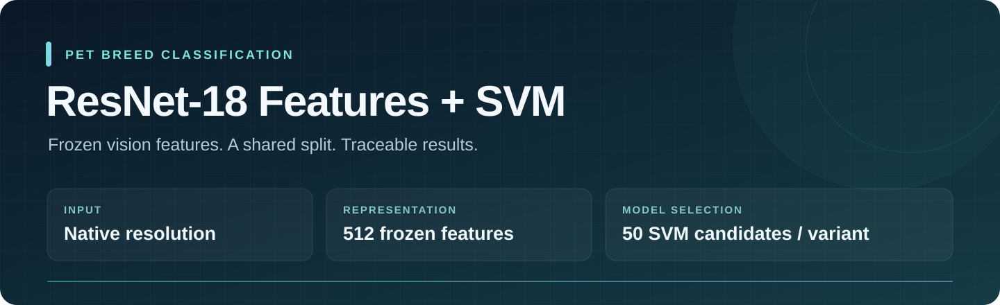

<p align="center">
  
</p>

<p align="center">
  <strong>One shared manifest. Two image variants. A traceable experiment.</strong>
</p>

<p align="center">
  <a href="START_HERE.md">Start here</a> ·
  <a href="docs/method.md">Method</a> ·
  <a href="docs/file_guide.md">Code guide</a> ·
  <a href="docs/reproducibility.md">Reproducibility</a> ·
  <a href="docs/DIRECTML.md">AMD / DirectML</a>
</p>

# ResNet-18 Features + SVM

Pet-breed classification using **frozen ImageNet ResNet-18 features** and a
**validation-selected support vector machine**. The code supports original
images and precomputed foreground images, with separate feature caches,
fitted models, and result folders for each variant.

- **Native resolution:** RGB conversion and fixed ImageNet normalization;
  no resize, crop, padding, augmentation, or EXIF transpose.
- **512 features per image:** replace the ResNet classifier with `Identity`,
  freeze every parameter, and run in evaluation mode under `torch.no_grad()`.
- **Train-only fitting:** fit `StandardScaler` and `SVC` on training features;
  choose a configuration on validation and evaluate the saved model separately.
- **Traceable runs:** record image hashes, manifest hashes, availability,
  package versions, candidate scores, settings, predictions, and error analysis.
- **Hardware choices:** CPU, CUDA, and explicit DirectML extraction;
  scikit-learn SVM fitting runs on CPU.

This edition adds English comments, docstrings, and documentation while keeping
the supplied Python logic and experiment defaults. It includes no model weights,
trained classifiers, feature caches, or pet-classification results.

## Before you run

> **The uploaded source ZIP did not contain `splits/manifest.csv` or saved split
> lists.** For reported experiments, supply the exact manifest used for those
> results. The generator can create a new seeded split, but cannot establish that
> its memberships match a missing historical manifest.

The bundled annotation texts contain **7,349 labelled images**: **3,680 official
trainval** and **3,669 official test**, across **37 breeds**. The generator is
configured for **2,944 train / 736 validation / 3,669 test**, using seed **42**.
These are target list counts, not guaranteed counts of available image files.

The original configuration also differs from the older documentation:

| Setting retained from the code | Meaning |
| --- | --- |
| `DEVICE = "directml"` | Explicit Windows/AMD extraction choice. Change to `"cpu"` or `"auto"` for a suitable different environment. |
| `SKIP_MISSING_IMAGES = True` | Skip absent listed files independently in each variant and report the actual subsets. |
| `OUTPUT_ROOT = ... / "resnet18_svm_outputs_available"` | All experiment outputs go under this root. |
| `BATCH_SIZE = 1`, `NUM_WORKERS = 0` | Process variable native image sizes one at a time. |

Missing files can cause the variants to use different training, validation, and
test samples. Review `available_manifest.csv`, `missing_images.csv`, and
`availability_summary.json` when interpreting comparisons. See
[the sample-policy details](docs/reproducibility.md#missing-images-and-comparability).

## Quick start

Use a Python **3.12** virtual environment. The commands below show a CPU setup;
use [the DirectML guide](docs/DIRECTML.md) for the retained AMD configuration,
or the [official PyTorch installer](https://pytorch.org/get-started/locally/)
for a compatible CUDA installation.

```bash
python -m venv .venv
```

Activate it using your terminal:

| Terminal | Command |
| --- | --- |
| Windows PowerShell | `.venv\Scripts\Activate.ps1` |
| Windows Command Prompt | `.venv\Scripts\activate.bat` |
| macOS / Linux | `source .venv/bin/activate` |

On Windows, the commands in [START_HERE.md](START_HERE.md) call the environment's
Python directly and do not require changing an activation policy.

```bash
python -m pip install --upgrade pip
python -m pip install torch torchvision --index-url https://download.pytorch.org/whl/cpu
python -m pip install -r requirements.txt
```

Edit the settings at the top of `resnet18_svm.py`. For this CPU setup:

```python
IMAGE_FOLDERS = {
    "original": Path(r"D:\Pets\original"),
    "foreground": Path(r"D:\Pets\background_removed_all"),
}
DEVICE = "cpu"
```

Replace the example paths with your actual directories. Both are read directly;
images do not need to be moved into this repository. Only top-level JPG/JPEG/PNG
files are indexed, matching by case-insensitive filename stem.

Place your agreed manifest at `splits/manifest.csv`, or follow
[the split options](START_HERE.md#step-1--supply-the-exact-split-membership).
Then run these stages in order, proceeding after each succeeds:

```bash
python resnet18_svm.py check
python self_test.py
python resnet18_svm.py audit --dataset both
python resnet18_svm.py smoke --dataset both
python resnet18_svm.py train --dataset foreground
python resnet18_svm.py train --dataset original
python resnet18_svm.py test --dataset both
```

The first real extraction downloads the official ImageNet weights unless they
are already in PyTorch's cache. Training automatically extracts or reuses the
required feature cache. The full sequence, expected reports, and troubleshooting
are explained in [START_HERE.md](START_HERE.md).

## Experiment settings

| Component | Supplied setting |
| --- | --- |
| Weights | `ResNet18_Weights.IMAGENET1K_V1` |
| Input | Stored width/height; convert RGB; tensor values in `[0, 1]` |
| Channel normalization | Mean `[0.485, 0.456, 0.406]`; std `[0.229, 0.224, 0.225]` |
| Feature layer | Adaptive global average pool → flatten → `Identity` classifier |
| Extractor state | Frozen parameters, `eval()`, `no_grad()` |
| Feature standardization | `StandardScaler`, fitted on training features only |
| SVM kernels | `linear`, `rbf` |
| C grid | 25 logarithmically spaced values, `0.001` to `1000` inclusive |
| RBF gamma | `"scale"` |
| Candidate count | 50 per variant with the default grid |
| Selection | Validation accuracy; exact ties keep the first grid candidate |
| Final fit | Retain the train-fitted winner; no train + validation refit |
| Scores | Uncalibrated SVM decision scores, not probabilities |

The same manifest and candidate grid are used for both variants; each variant
fits its own scaler and SVM. This package preserves source image dimensions;
it does not generate resized input datasets or perform background removal.
The foreground branch expects already prepared images.

## Commands

```bash
python resnet18_svm.py --help
```

| Stage | Purpose |
| --- | --- |
| `check` | Record package versions and test a tensor operation on the selected device. |
| `audit` | Check input IDs, annotations, manifest validity, and available rows. |
| `smoke` | Extract up to 16 shared training images and verify dimensions and feature alignment. |
| `extract` | Build or reuse the full available manifest-image feature cache. |
| `train` | Fit candidate pipelines on train and choose one using validation. |
| `test` | Evaluate an already saved model on available test rows. |
| `predict` | Classify one image with a saved variant-matched model. |

The CLI defaults to `--dataset foreground`; use `--dataset both` explicitly for
paired audit, smoke, extraction, training, or testing. Both branches run
sequentially, foreground first.

```bash
python resnet18_svm.py extract --dataset both
python resnet18_svm.py train --dataset foreground --refresh-cache
python resnet18_svm.py test --dataset original --model "/path/to/best_model.joblib"
python resnet18_svm.py predict --dataset original --image "/path/to/photo.jpg"
```

`--model` requires one variant; `predict` also requires one variant and `--image`.
`--refresh-cache` affects extract/train/test; it is not a new sampling command.

## Where results go

All paths below are relative to `resnet18_svm_outputs_available/`:

| Path | Contents |
| --- | --- |
| `environment_report.json` | Package versions and selected-device check. |
| `data_audit/` | Pairing, official labels, class map, and audit summary. |
| `<variant>/data_audit/` | Available manifest, missing-image CSV, availability summary. |
| `<variant>/smoke_tests/smoke_.../` | Training sample IDs, sample features, and checks. |
| `<variant>/feature_cache/features.npz` | Full available listed-image features and provenance. |
| `<variant>/runs/run_.../` | Validation grid, predictions, C curve, fitted model, settings, availability. |
| `<variant>/latest_model.json` | Absolute path to the most recent successful model. |
| `<variant>/runs/run_.../test_.../` | Test predictions, metrics, score columns, confusion matrix, errors, availability. |

Training and testing create new UTC timestamped run folders. Feature caches,
audit reports, and the latest-model pointer are reused/updated. After moving a
project, supply a model's new path explicitly with `--model` if necessary.

## Repository files

| File | Role |
| --- | --- |
| [`resnet18_svm.py`](resnet18_svm.py) | Settings, feature extraction/cache, SVM selection, testing, prediction. |
| [`oxford_annotations.py`](oxford_annotations.py) | Official annotation loading, consistency checks, manifest validation. |
| [`generate_shared_splits.py`](generate_shared_splits.py) | Deliberately generate a new seeded stratified split. |
| [`build_manifest_from_ids.py`](build_manifest_from_ids.py) | Fill official labels around an existing validation-ID list. |
| [`merge_split_csvs.py`](merge_split_csvs.py) | Merge three existing split CSVs without reassigning images. |
| [`self_test.py`](self_test.py) | Offline synthetic functional tests; optional untrained ResNet structure check. |
| [`annotations/`](annotations/) | Original supplied label texts and their original README. |
| [`splits/README.md`](splits/README.md) | Missing-manifest notice and required schema. |

See [the annotated code guide](docs/file_guide.md) for function-level responsibilities.

## Verification

```bash
python -m compileall -q .
python self_test.py
```

The supplied suite covers row/label alignment, split leakage checks, train-only
standardization, cache invalidation, model selection, separate variant outputs,
smoke reports, and result exports. Tests use temporary synthetic data and never
download pretrained weights. An optional structure test constructs an untrained
ResNet when torch/torchvision are installed.

Local validation for this edition: **18 tests discovered, 17 passed, 1 skipped**.
The skipped test requires torch/torchvision, which were not installed in the
verification environment. The Python executable statements match the supplied
six scripts after excluding docstrings and two renamed documentation references
in error messages. Annotation files are retained byte-for-byte. See
[verification scope](docs/reproducibility.md#verification-of-this-edition).

The included GitHub Actions workflow installs CPU PyTorch and runs the suite.
It has not been executed on GitHub as part of preparing this archive. No real
ImageNet feature extraction, GPU run, or full pet experiment was executed here.

## Further reading and attribution

- [Step-by-step execution guide](START_HERE.md)
- [Processing and model-selection method](docs/method.md)
- [Reproducibility, caches, and missing images](docs/reproducibility.md)
- [Revision notes](CHANGELOG.md)
- [Oxford-IIIT Pet dataset and original research](https://www.robots.ox.ac.uk/~vgg/data/pets/)
- [Torchvision ResNet-18 weights and default transforms](https://docs.pytorch.org/vision/stable/models/generated/torchvision.models.resnet18.html)
- [scikit-learn SVC](https://scikit-learn.org/stable/modules/generated/sklearn.svm.SVC.html)

The bundled annotation README attributes the dataset to Omkar M. Parkhi,
Andrea Vedaldi, Andrew Zisserman, and C. V. Jawahar, *Cats and Dogs*, CVPR 2012.
Dataset terms remain those of the original creators; their README is preserved.
No new software license has been assigned in this packaging revision.
